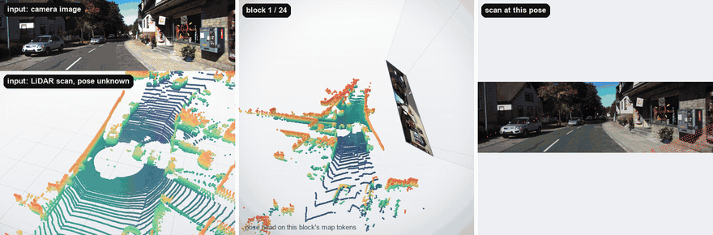
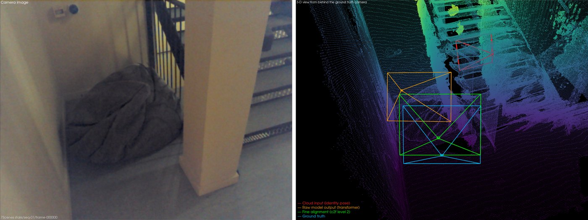
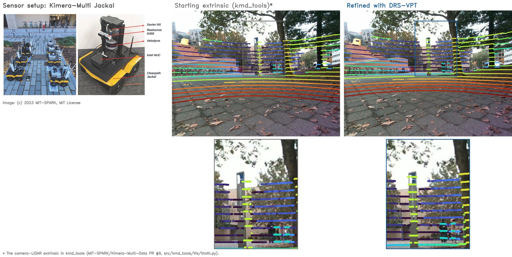

# DRS-VPT: Directly Relocalizing in a Scan with Vision Point Transformers

DRS-VPT localizes a single camera image inside a 3-D point cloud map, with no pose prior. One model works for driving
LiDAR scans and indoor maps. It also calibrates a camera to a LiDAR without targets.

<p align="center">
  <a href="https://ori-drs.github.io/drs-vpt-pages/"></a>&nbsp;
  <a href="https://arxiv.org/abs/2609.12557"></a>&nbsp;
  <a href="https://eccv.ecva.net/virtual/2026/poster/5967"></a>&nbsp;
  <a href="https://huggingface.co/spaces/fulkast/drs-vpt-demo"></a>
</p>

**Try it in your browser:** upload a photo and a point cloud of the same place, and see the camera placed in the map. No
install needed: [DRS-VPT demo on Hugging Face](https://huggingface.co/spaces/fulkast/drs-vpt-demo).

<p align="center">
  <a href="https://huggingface.co/spaces/fulkast/drs-vpt-demo"></a>
</p>

## Install

<details>
<summary>Linux with an NVIDIA GPU (CUDA 12.8 build; works on Blackwell)</summary>

```bash
git clone https://github.com/ori-drs/drs-vpt.git && cd drs-vpt
conda create -n drs_vpt python=3.12 -y && conda activate drs_vpt
pip install torch==2.8.0 torchvision --index-url https://download.pytorch.org/whl/cu128
pip install spconv-cu126 torch-scatter -f https://data.pyg.org/whl/torch-2.8.0+cu128.html
pip install -e ".[viz,dev]"
pytest tests
```

</details>

<details>
<summary>Linux, CPU only</summary>

```bash
git clone https://github.com/ori-drs/drs-vpt.git && cd drs-vpt
conda create -n drs_vpt python=3.12 -y && conda activate drs_vpt
pip install torch==2.8.0 torchvision --index-url https://download.pytorch.org/whl/cpu
# spconv-cu126 also runs on CPU; the plain spconv wheel is not thread-safe
pip install spconv-cu126 torch-scatter -f https://data.pyg.org/whl/torch-2.8.0+cpu.html
pip install -e ".[viz,dev]"
pytest tests
```

</details>

<details>
<summary>macOS (CPU; builds the spconv copy in <code>third_party/</code>)</summary>

```bash
xcode-select --install                                  # C++ toolchain, once
git clone https://github.com/ori-drs/drs-vpt.git && cd drs-vpt
conda create -n drs_vpt python=3.12 -y && conda activate drs_vpt
pip install torch torchvision
pip install -e ".[viz,dev]"
pip install -e third_party/ccimport --no-deps
CPU_ONLY=1 pip install -e third_party/cumm
CPU_ONLY=1 pip install -e third_party/spconv --no-build-isolation
pip install torch-scatter --no-build-isolation
pytest tests                                            # the first run compiles spconv's C++ (about 30 s)
```

</details>

The model weights (2.9 GB) and the demo samples download from the Hugging Face Hub on first use.

## Demo

```bash
python scripts/demo.py                                 # KITTI sample with its K: prints the pose and its error
python scripts/demo.py --predict-intrinsics            # the same without K: the intrinsics are predicted
python scripts/demo.py --sample 7scenes --viz3d        # indoor sample, with a 3-D view
python scripts/demo.py --sample iphone_stream          # many frames against one map
```

The figures are saved in `demo_output/`. `--viz3d-show` opens the 3-D view interactively; `--viz3d` saves it, e.g. for
the 7-Scenes sample (left: the query image; right: the map seen from behind the ground-truth camera, with the
transformer's pose, the refined pose and the ground truth):

<p align="center">
  
</p>

## Python API

Localize an image in a point cloud, or calibrate a camera to a LiDAR: the pose of the cloud in the camera.

```python
from drs_vpt.hub import load_model, load_sample
from drs_vpt.inference import calibrate, read_image

model = load_model(device="cuda")

sample = load_sample("kitti")
frame = sample["frames"][0]
image = read_image(frame["img_path"])   # (H, W, 3) uint8 RGB
K = frame["K"]                          # 3x3 intrinsics of the image
cloud = sample["cloud"]                 # (N, 3) float32 point cloud in metres
grid_size = sample["grid_size"]         # voxel size in metres: 0.02 outdoors, 0.005-0.01 indoors

out = calibrate(model, [(image, K, cloud)], grid_size)
print(out["T_cam_lidar"])               # 4x4 cloud-to-camera: x_cam = R @ x_cloud + t

out = calibrate(model, [(image, None, cloud)], grid_size)   # without K: the intrinsics are predicted
print(out["T_cam_lidar"])
```

`QUICKSTART.md` has the code map, the sample folder format and hardware notes.

## Reproducing the KITTI and nuScenes results

`scripts/eval.py` runs the released model on a test set and reports the paper's metrics: the rotation error (RRE, deg)
and the camera-centre error (RTE, m), as mean and median, and the recall at RRE < 5° and RTE < 2 m.

```bash
python scripts/eval.py --dataset kitti    --data /data/kitti_vp2p_eval_data
python scripts/eval.py --dataset nuscenes --data /data/nuscenes_test_processed/test
python scripts/eval.py --dataset kitti    --data /data/kitti_vp2p_eval_data --limit 20   # quick check
```

Samples run 8 at a time on the GPU (`--batch-size`) while 8 processes (`--workers`) load and voxelize the next ones;
lower `--batch-size` if the GPU runs out of memory.
Each sample's result is written to `eval_output/<dataset>/<name>.json` (an interrupted run resumes), and the summary
to `eval_output/<dataset>/summary.json`. The same evaluation from Python:

```python
from drs_vpt.eval import evaluate, kitti_samples, summarize
from drs_vpt.hub import load_model

model = load_model(device="cuda")
results = evaluate(model, kitti_samples("/data/kitti_vp2p_eval_data"), out_dir="eval_output/kitti")
summarize(results)   # {"n", "recall", "rre_mean_deg", "rre_median_deg", "rte_mean_m", "rte_median_m"}
```

**Data.** Each scan is moved by a random rigid transform (up to ±10 m in x and z, any yaw), seeded with the sample index.

KITTI (sequences 09 and 10, about 10 GB):

```bash
python scripts/download_kitti_eval.py --out /data/kitti_vp2p_eval_data
```

nuScenes: register at [nuscenes.org](https://www.nuscenes.org/nuscenes#download), download `v1.0-test_meta.tgz` and
`v1.0-test_blobs.tgz` into `~/Downloads/nuscenes`, then:

```bash
mkdir -p /raw/nuscenes/test
for f in ~/Downloads/nuscenes/v1.0-test_{meta,blobs}.tgz; do tar -xzf "$f" -C /raw/nuscenes/test; done
conda create -n nuscenes python=3.8 -y
conda run -n nuscenes pip install nuscenes-devkit opencv-python
conda run -n nuscenes python data_processing/nuscenes_preprocess.py --dataroot /raw/nuscenes/test \
    --version v1.0-test --frame_skip 2 --out /data/nuscenes_test_processed/test
```

**Results** of the commands above with the released model, after the code refactor for this release. t and r are the
mean / median translation and rotation errors; accuracy is the recall at 2 m / 5°.

| | t [m] | r [°] | accuracy [%] |
|---|---|---|---|
| KITTI | 0.08 / 0.05 | 0.28 / 0.22 | 99.71 |
| nuScenes | 0.31 / 0.13 | 0.80 / 0.31 | 97.62 |

## Localization

To localize many images in the same map, encode the map once with `encode_map` and `localize` each image against
it, so each image only pays for the image side.

```python
from drs_vpt.hub import load_model, load_sample
from drs_vpt.inference import encode_map, localize, read_image

model = load_model(device="cuda")
stream = load_sample("iphone_stream")   # 37 frames in one map
map_encoding = encode_map(model, stream["cloud"], stream["grid_size"])
for frame in stream["frames"]:
    out = localize(model, read_image(frame["img_path"]), map_encoding, frame["K"])   # K=None predicts it
    print(out["T_w2c"])                 # 4x4 world-to-camera; out["K"]: the K used, at the model's resolution
```

A video of DRS-VPT localizing and calibrating across driving and indoor scenes:

<p align="center">
  <a href="https://www.youtube.com/watch?v=4mya_aEEeXU">
    
  </a>
</p>

## Joint calibration

`calibrate` also takes several synced image / scan pairs from a fixed camera and LiDAR, and solves for one extrinsic
shared by all of them. On KITTI (sequence 09, after `scripts/download_kitti_eval.py`):

```python
import numpy as np
from drs_vpt.hub import load_model
from drs_vpt.inference import calibrate, read_image

model = load_model(device="cuda")
kitti = "/data/kitti_vp2p_eval_data"
sequence = f"{kitti}/sequences/09"

# Intrinsics of the left colour camera, from KITTI's calibration file
calib = {}
for line in open(f"{kitti}/calib/09/calib.txt"):
    key, values = line.split(":", 1)
    calib[key] = np.array(values.split(), dtype=np.float64)
K = calib["P2"].reshape(3, 4)[:, :3]

# Six synced image / LiDAR scan pairs
frames = []
for i in range(6):
    image = read_image(f"{sequence}/image_2/{i:06d}.png")
    scan = np.fromfile(f"{sequence}/velodyne/{i:06d}.bin", dtype=np.float32).reshape(-1, 4)   # x, y, z, intensity
    frames.append((image, K, scan[:, :3]))

out = calibrate(model, frames)
print(out["T_cam_lidar"])   # 4x4 LiDAR-to-camera: x_cam = R @ x_lidar + t
```

DRS-VPT can also refine an existing calibration. On the
[Kimera-Multi dataset](https://github.com/MIT-SPARK/Kimera-Multi-Data) (Tian et al., 2023; a Clearpath Jackal with a
Velodyne LiDAR and a RealSense D455), LiDAR points projected into the camera image with a starting
extrinsic[^kimera-extrinsic] (middle) and after refining it with DRS-VPT (right). Robot photo and data: © 2023
MIT-SPARK, [MIT License](https://github.com/MIT-SPARK/Kimera-Multi-Data/blob/master/LICENSE).

[^kimera-extrinsic]: The camera-LiDAR extrinsic in `kmd_tools`
    ([MIT-SPARK/Kimera-Multi-Data PR #9](https://github.com/MIT-SPARK/Kimera-Multi-Data/pull/9),
    `src/kmd_tools/tfs/thoth.py`).

<p align="center">
  
</p>


## Training

See [train.md](train.md) for the training setup, scripts and configuration. After preparing the KITTI training data
(`data_processing/README.md`), fine-tune the released weights on KITTI only:

```bash
pip install -e ".[train]"
bash bash_scripts/train/examples/drsvpt_kitti_4v_15ipg.sh 1    # number of GPUs
```

## Acknowledgments

We thank the following projects for their open-source code:
[MapAnything](https://github.com/facebookresearch/map-anything), [Sonata](https://github.com/facebookresearch/sonata),
[DINOv2](https://github.com/facebookresearch/dinov2), [PixLoc](https://github.com/cvg/pixloc) and
[DUSt3R](https://github.com/naver/dust3r).

## Licence

The code is Apache 2.0 (`LICENSE`); vendored code keeps its upstream licence. The model weights are CC BY-NC 4.0
(non-commercial use only).

## Citation

```bibtex
@inproceedings{fu2026drsvpt,
  title     = {{DRS}-{VPT}: Directly Relocalizing in a Scan with Vision Point Transformers},
  author    = {Fu, Lanke Frank Tarimo and Fallon, Maurice},
  booktitle = {Proceedings of the European Conference on Computer Vision (ECCV)},
  year      = {2026}
}
```
